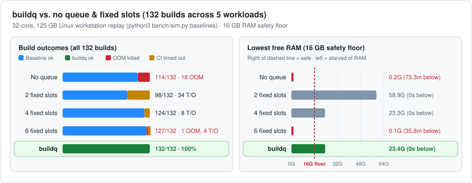
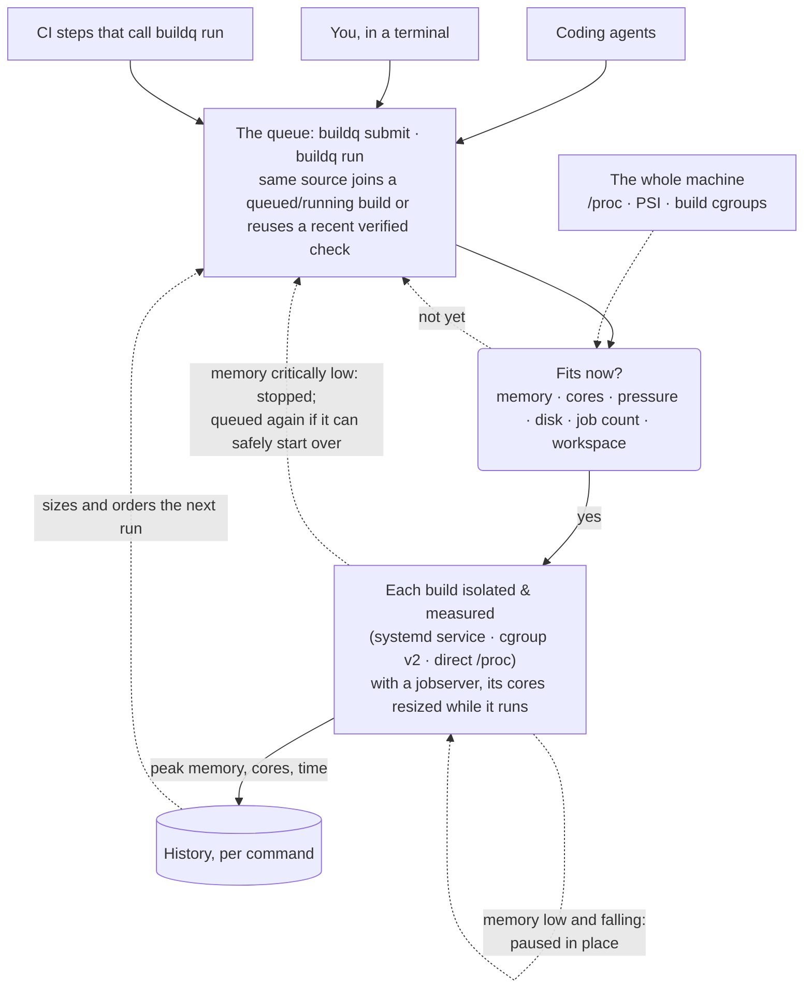
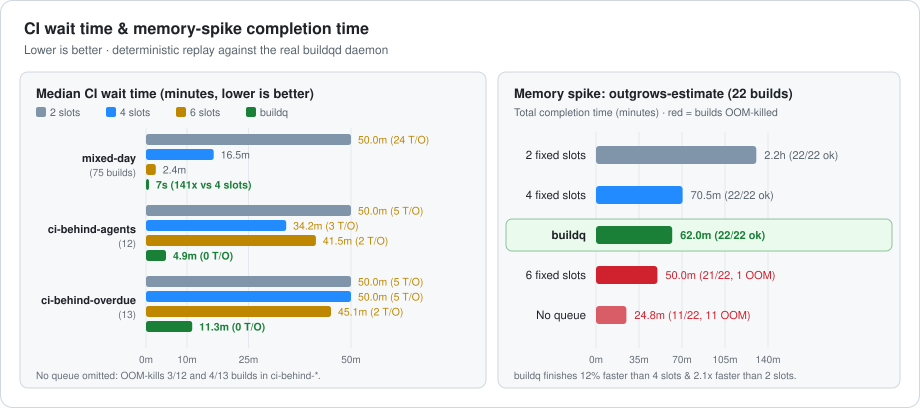

# buildq

A local build queue for Linux that keeps parallel builds, coding agents, and CI runners from crashing the machine out of memory without leaving CPUs idle.

Drop off a build, get a ticket; `buildq` starts it when the machine has the RAM and CPU for it, resizes `cargo`, `make`, and `ninja` jobs live as load changes, and pauses or restarts builds if memory runs tight anyway.

[](https://github.com/nosliwsirhc/buildq/actions/workflows/tests.yml)


[](LICENSE)

Open source under the [MIT License](LICENSE); everything is in this repository.

## The problem

When multiple coding agents (Claude Code, Codex, Cursor, Antigravity), terminal sessions, or self-hosted GitHub Actions runners share one Linux machine:

- **Without a queue:** everything starts at once (`cargo test`, `make -j`, `pytest`, `vitest`) until the machine freezes and the Linux OOM killer starts crashing builds.
- **With fixed slots** (`pueue`, `task-spooler`, `flock`): set the limit low and CPU cores sit idle while CI jobs time out in line; set it high and heavy builds still run the machine out of memory.
- **With `buildq`:** builds are admitted using live machine RAM and CPU measurements plus learned per-command history. Parallel builds (`cargo`, `make`, `ninja`) are resized while they run, and builds are paused or cleanly restarted if memory runs tight anyway.

## Measured results

Across five shared-workstation replay workloads (132 builds on a 32-core, 125 GB Linux machine covering agent bursts, self-hosted CI releases, surprise memory spikes, and a busy mixed workday):

- **100% of builds finish (132 / 132)**, compared to 86% with no queue (18 OOM crashes) and 74–96% with fixed slots (4–34 timed-out CI jobs).
- **Zero OOM crashes and zero low-memory freezes:** free RAM never dropped below the 16 GB safety buffer, compared to 73.3 minutes starved of RAM with no queue and 35.8 minutes with 6 fixed slots.
- **7-second typical CI wait on a busy day:** 141× shorter than 4 fixed slots (16.5 minutes), with zero timed-out releases across every scenario.
- **Up to 2.1× faster than safe fixed slots** during memory-heavy bursts: finishes 22 builds in 62.0 minutes vs. 2.2 hours (2 slots) or 70.5 minutes (4 slots), with zero crashes.

<picture>
  <source media="(prefers-color-scheme: dark)" srcset="docs/images/benchmark-overview-dark.svg">
  <source media="(prefers-color-scheme: light)" srcset="docs/images/benchmark-overview-light.svg">
  
</picture>

| Setup | Builds finished | Crashed (OOM) | CI timed out | Time starved of RAM (<16 GB free) | Lowest free RAM |
| --- | ---: | ---: | ---: | ---: | ---: |
| **No queue** (run everything at once) | 114 / 132 (86%) | 18 | 0 | 73.3 min | 0.2 GB |
| **2 fixed slots** | 98 / 132 (74%) | 0 | 34 | 0 s | 58.9 GB |
| **4 fixed slots** | 124 / 132 (94%) | 0 | 8 | 0 s | 23.3 GB |
| **6 fixed slots** | 127 / 132 (96%) | 1 | 4 | 35.8 min | 0.1 GB |
| **buildq** | **132 / 132 (100%)** | **0** | **0** | **0 s** | **23.4 GB** |

> **Real Linux hardware check:** on a Linux 6.12 KVM machine (4 vCPUs, 2 GB RAM, no swap) compiling C code with `gcc -O2` and `make -j4`, running without a queue caused 3 kernel OOM kills (7/10 finished). `buildq` finished 10/10 with 0 OOM kills, 3.3× faster CI turnaround than 2 safe fixed slots (`8.8 s` vs. `28.8 s`), and >1 GB RAM free throughout.
>
> Reproduce the full replay benchmark locally in a few seconds (no root, no extra packages): `python3 bench/sim.py baselines`. [See all per-scenario numbers and trade-offs below.](#benchmarks-the-full-numbers)

## What makes it different

Fixed-slot queues treat every build as "1 slot" and ignore what runs outside them. `buildq` schedules from live machine measurements and kernel feedback:

- **Live GNU Make FIFO jobserver resizing:** Gives `cargo`, GNU `make` 4.4+ (older `make` falls back to `-j`), and `ninja` 1.13+ a per-build FIFO jobserver (`--jobserver-auth=fifo:...`), injecting or draining tokens every 5 seconds while builds run. One build on an idle box scales up; when three more arrive, it hands cores back without restarting.
- **Learned footprints, zero manifests:** Measures unreclaimable memory (`anon + shmem + kernel - slab_reclaimable` in cgroups; `smaps_rollup` PSS in `direct` mode) alongside whole-machine load, holds growth headroom before a build's late peak, and can release unused memory reservations past the peak (`release_after_peak`). When memory tightens anyway, it pauses the newest build and stops builds (requeueing restart-safe ones) before the machine stalls.
- **Zero external dependencies, zero root:** Pure Python 3.11+ standard library and POSIX `/bin/sh` (`dash`-tested). No Redis, no Docker, no background database server, and no compiler required to install.
- **Works on every Linux setup:** Native systemd user services with dynamic `slice_guard` (Ubuntu, Fedora, Arch, Debian), a zero-setup `direct` runner (`PR_SET_CHILD_SUBREAPER` + 1 s `MemoryMax` watchdog + pidfd-verified `SIGSTOP`/`SIGCONT`) on Alpine, Void, Gentoo, Artix, Devuan, WSL2, and Docker/Podman, plus optional pure cgroup v2 without systemd.
- **Git-fingerprinted dedup and verified check reuse:** Repeat submissions on the same tree (`HEAD` + dirty diff + untracked files + `.env*`) join the live ticket. Passing checks within `reuse_window` (2 h default), verified at both start and end so mid-build edits never poison reuse, return immediately.
- **Shell-native for coding agents (no MCP server):** Runs in the agent's shell rather than an MCP server so builds keep the caller's exact `cwd`, environment, and ulimits. Includes drop-in `PATH` shims (`--shims`), optional `RUSTC_WRAPPER` guard (`--rustc-guard`), an agent skill (`--skill` + `buildq help agents`), and `submit`/`wait` tickets that survive tool-call timeouts and auto-cancel abandoned queued builds after a session exits.
- **Built-in observability and polyglot tool support:** `btop`-style `buildq top` (braille CPU graph, single-bar memory ledger, `t` timeline, disk I/O, cache sizes) and read-only SQLite `buildq query` over `metrics.db`, with out-of-the-box support for Cargo, Make, Ninja, .NET, Gradle/`gradlew`, CMake/CTest, Zig, GCC/Clang, Python (`pytest`/`unittest`/`mypy`/`pyright`/`uv`), Go, JS/TS (`pnpm`/`npm`/`yarn`/`vitest`/`tsc`/`eslint`), and Docker/Podman image builds.

## Quick start

You need **Linux** and **Python 3.11+**. Works with systemd **or** without it (Alpine/OpenRC, Void/runit, Gentoo, Artix/s6/dinit, Devuan/SysVinit, WSL2, Docker/Podman). Zero external Python dependencies, no root required.

```sh
git clone https://github.com/nosliwsirhc/buildq.git
cd buildq
./install.sh                       # check system, install/upgrade, and start the daemon
./install.sh --check               # optional: check compatibility & dependencies without installing
./install.sh --shims               # optional: heavy commands go through the queue automatically
./install.sh --rustc-guard=~/src   # optional: refuse to compile Rust under ~/src outside the queue
./install.sh --skill               # optional: install a skill teaching coding agents to use buildq
./install.sh --auto-update         # optional: enable the systemd user timer for automatic updates
```

Drop off a build (example from a workstation with a `heavy` lane and past history; a fresh install starts with one `default` lane):

```console
$ buildq submit -- cargo test -p api
3f2a91c0-7c1e-4d55-9a0e-2b8f1c6d9e11
buildq: ticket 3f2a91c0-7c1e-4d55-9a0e-2b8f1c6d9e11 [heavy] queued for 0s: needs 18G of memory; 9.6G is free ...

$ buildq status 3f2a
ticket 3f2a91c0-7c1e-4d55-9a0e-2b8f1c6d9e11  (heavy lane)
  state     running for 4m12s, after 1m03s in the queue
  command   cargo test -p api
  in        ~/src/project/api
  using     7.6 cores, 11G now; peak 14G, 8.0 cores
  cores     8 given (resized live through its jobserver); it can use up to 12
  expected  8 cores, 18G (largest of the last 6 runs)
  log       ~/.local/state/buildq/tickets/3f2a91c0-.../output.log

$ buildq wait 3f2a; echo "exit $?"
buildq: 3f2a91c0 succeeded after 6m40s; peak 14G, 8.0 cores
exit 0
```

<details>
<summary><strong>What <code>install.sh</code> sets up (systemd, non-systemd, upgrades, and uninstall)</strong></summary>

`install.sh` uses `dash`-tested POSIX `/bin/sh` (no `bash` needed), checks compatibility and dependencies up front, and offers a `[y/N]` prompt (or `--install-deps`) to install missing prerequisites via your package manager (`apt`, `dnf`, `pacman`, `apk`, `xbps-install`, `zypper`, or `emerge`).

- Installs `buildq`, `buildqd`, `buildq-shim`, and `buildq-rustc-guard` into `~/.local/bin` (change with `PREFIX`), pinned to the Python 3.11+ it verified (`PYTHON=...` to choose one) so switching virtualenvs won't break them, with versioned folders under `~/.local/lib/buildq/` so upgrades don't disturb running builds.
- Creates `~/.config/buildq/config.toml` with sensible defaults if you don't have one yet.
- On **systemd** machines: installs and starts the user background service (`buildq.service`) with a 75%/85% aggregate memory safety cap (`buildq.slice`) that tightens automatically whenever other programs need RAM (`slice_guard`).
- On **non-systemd** machines: starts `buildqd` directly in the background (logs in `~/.local/state/buildq/buildqd.log`), ready to use right away. Pass `--no-start` in Dockerfiles or packaging scripts. For boot-time startup (OpenRC, runit, s6, dinit, SysVinit) or optional kernel memory limits without systemd, see [`init/README.md`](init/README.md).
- To keep the daemon running after you log out: run `loginctl enable-linger "$USER"` on systemd machines, or use a boot service from [`init/`](init/README.md) (or `@reboot ~/.local/bin/buildq daemon start`) on non-systemd machines.
- To upgrade later, run `buildq update` (or `./install.sh` again): running builds finish normally and queued builds keep their place. Pass `--auto-update` (or run `buildq update --enable`) to enable a periodic systemd user timer (`buildq-update.timer`). `./install.sh --uninstall` stops the daemon and removes everything except your config and build history.

</details>

## How it works



Every build runs under a lightweight supervisor so `buildq` can measure it, cap its resources, pause
it if memory runs short, and clean up all of its child processes when it finishes. By default
(`runner = "auto"`), `buildq` detects your Linux setup automatically:

1. **With systemd (Ubuntu, Fedora, Arch, Debian, …):** runs each build as a private user service
   inside `buildq.slice`, using systemd and the Linux kernel for memory caps, pausing, and cleanup.
2. **Without systemd, out of the box (Alpine, Void, Gentoo, Artix, Devuan, WSL2, Docker/Podman):**
   zero setup and no root needed: tracks each build's full process tree, limits its cores, pauses
   it if RAM runs low, stops builds that pass their memory cap, and cleans up every child process.
3. **Optional kernel caps without systemd (`cgroup`):** on non-systemd machines that have Linux
   cgroup v2, running one boot-time script ([`init/cgroup-setup.sh`](init/cgroup-setup.sh)) gives
   builds the same kernel-enforced memory limits and freezing as systemd. See
   [`init/README.md`](init/README.md).

What each build used is recorded under its command (repository, lane, tool, subcommand, package),
and the next run of that command is planned from it. The daemon re-plans every second and whenever
a build arrives or ends.

## Benchmarks: the full numbers

The headline table at the top comes from `bench/sim.py`, a deterministic replay suite that drives the
real `buildqd` daemon against five workloads modeled on a 32-core, 125 GB workstation (with 26 GB and
3 cores held by background work), compared against **no queue** (everything starts immediately) and
**fixed FIFO slots** (`2`, `4`, `6`, like `pueue`, `task-spooler`, or a `flock` slot script):

- **Surprise memory spike (`outgrows-estimate`, 22 builds):** Two builds grow from a 3 GB history to
  24 GB while twenty 12 GB builds arrive. Without a queue, half the builds (11/22) are OOM-killed.
  With 6 fixed slots, one still OOMs and free RAM drops to 0.1 GB. Safe fixed slots finish in 2.2 h
  (2 slots) or 70.5 min (4 slots). `buildq` finishes all 22/22 in 62.0 min (12% faster than 4 slots,
  2.1× faster than 2 slots) with 0 OOM kills and 23.4 GB minimum free RAM.
- **CI release behind 7 long agent builds (`ci-behind-agents`, 12 builds):** Without a queue, 3/12
  builds OOM. Behind 2, 4, or 6 fixed slots, 2 to 5 CI jobs time out (median CI wait 34–50 min).
  `buildq` completes 12/12 in 1.5 h with 0 OOM kills, 0 CI timeouts, and a 4.9 min median CI wait
  (max 5.0 min).
- **CI release behind overdue agent builds (`ci-behind-overdue`, 13 builds):** Without a queue, 4/13
  builds OOM. Behind 2 or 4 fixed slots, all 5 CI jobs time out (6 slots: 2 time out). `buildq`
  completes 13/13 with 0 OOM kills, 0 CI timeouts, 1 preemptive stop, and 11.3 min median CI wait
  (max 12.0 min).
- **Two-hour mixed workday (`mixed-day`, 75 builds):** 2 fixed slots times out 24/32 CI jobs; 4 fixed
  slots leaves CI waiting 16.5 min median (32.8 min max). `buildq` completes 75/75 with 7 s median
  CI wait (141× shorter than 4 slots), 35.7 min median agent turnaround, and never drops below
  41.7 GB free RAM.
- **Ten cargo builds at once (`burst`, 10 builds):** No queue dips below the 16 GB RAM floor for
  68 s (13.0 GB min RAM); 2 fixed slots takes 66.5 min with 34,120 idle core-seconds. `buildq`
  finishes 10/10 in 40.0 min (28.1 min median turnaround, 50.4 GB min RAM, 0 s below the floor, and
  362 idle core-seconds).

**Honest trade-offs:** `buildq` keeps a 16 GB RAM safety margin and prioritizes CI releases, so on
steady workloads that happen not to OOM without a queue (`mixed-day`), individual agent builds trade
a few extra minutes of median turnaround (`35.7 min` vs. `27.9 min` for 4 slots) in exchange for zero
OOM kills, zero CI timeouts, and an interactive machine. Raw makespan can also look shorter without
a queue on overloaded scenarios only because 25–50% of the builds crashed to OOM instead of
finishing.

```sh
python3 bench/sim.py baselines   # reproduce all 5 scenarios locally in a few seconds
```

<picture>
  <source media="(prefers-color-scheme: dark)" srcset="docs/images/benchmark-scenarios-dark.svg">
  <source media="(prefers-color-scheme: light)" srcset="docs/images/benchmark-scenarios-light.svg">
  
</picture>

<details>
<summary><strong>Full per-scenario tables (all 5 workloads, 132 builds)</strong></summary>

#### `burst` (10 builds: ten cargo builds at once)

| Metric | No queue | 2 slots | 4 slots | 6 slots | buildq |
| --- | ---: | ---: | ---: | ---: | ---: |
| Succeeded | 10/10 | 10/10 | 10/10 | 10/10 | **10/10** |
| OOM kills | 0 | 0 | 0 | 0 | **0** |
| Makespan | 33.5m | 66.5m | 38.3m | 35.1m | 40.0m |
| Agent turnaround p50 | 30.8m | 38.0m | 25.0m | 23.2m | 28.1m |
| Least free RAM | 13.0G | 78.7G | 59.3G | 48.7G | 50.4G |
| Time below 16G floor | 68s | 0s | 0s | 0s | **0s** |
| Idle core-s (waiting) | 0 | 34,120 | 0 | 0 | 362 |

#### `ci-behind-agents` (12 builds: a release arrives behind seven long agent test builds)

| Metric | No queue | 2 slots | 4 slots | 6 slots | buildq |
| --- | ---: | ---: | ---: | ---: | ---: |
| Succeeded | 9/12 | 7/12 | 9/12 | 10/12 | **12/12** |
| OOM kills | 3 | 0 | 0 | 0 | **0** |
| CI timed out | 0 | 5 | 3 | 2 | **0** |
| Makespan | 59.0m | 2.1h | 75.0m | 74.9m | 1.5h |
| CI wait p50 / max | 0s / 0s | 50.0m / 50.0m | 34.2m / 49.9m | 41.5m / 42.5m | **4.9m / 5.0m** |
| Agent turnaround p50 | 47.5m | 71.0m | 39.2m | 52.4m | 66.9m |
| Least free RAM | 1.0G | 66.4G | 33.8G | 4.5G | 35.7G |
| Time below 16G floor | 34.1m | 0s | 0s | 25.5m | **0s** |
| Idle core-s (waiting) | 0 | 69,986 | 116 | 0 | 3,711 |

#### `ci-behind-overdue` (13 builds: a release arrives behind agent builds that have waited past overdue)

| Metric | No queue | 2 slots | 4 slots | 6 slots | buildq |
| --- | ---: | ---: | ---: | ---: | ---: |
| Succeeded | 9/13 | 8/13 | 8/13 | 11/13 | **13/13** |
| OOM kills | 4 | 0 | 0 | 0 | **0** |
| CI timed out | 0 | 5 | 5 | 2 | **0** |
| Makespan | 1.6h | 3.4h | 1.9h | 1.6h | 2.3h |
| CI wait p50 / max | 0s / 0s | 50.0m / 50.0m | 50.0m / 50.0m | 45.1m / 48.6m | **11.3m / 12.0m** |
| Agent turnaround p50 | 84.1m | 2.6h | 75.0m | 83.9m | 1.5h |
| Least free RAM | 1.0G | 71.8G | 45.7G | 20.4G | 41.4G |
| Time below 16G floor | 25.7m | 0s | 0s | 0s | **0s** |
| Idle core-s (waiting) | 0 | 146,555 | 1,494 | 0 | 2,824 |

#### `mixed-day` (75 builds: two hours of agents' builds, four releases, a PR check every ten minutes)

| Metric | No queue | 2 slots | 4 slots | 6 slots | buildq |
| --- | ---: | ---: | ---: | ---: | ---: |
| Succeeded | 75/75 | 51/75 | 75/75 | 75/75 | **75/75** |
| OOM kills | 0 | 0 | 0 | 0 | **0** |
| CI timed out | 0 | 24 | 0 | 0 | **0** |
| Makespan | 3.2h | 4.4h | 3.3h | 3.3h | 3.6h |
| CI wait p50 / max | 0s / 19.2m | 50.0m / 50.0m | 16.5m / 32.8m | 2.4m / 15.2m | **7s / 15.8m** |
| Agent turnaround p50 | 23.9m | 76.6m | 27.9m | 21.8m | 35.7m |
| Least free RAM | 27.0G | 74.0G | 52.1G | 38.8G | 41.7G |
| Time below 16G floor | 0s | 0s | 0s | 0s | **0s** |
| Idle core-s (waiting) | 40,160 | 179,392 | 47,003 | 49,659 | 42,377 |

#### `outgrows-estimate` (22 builds: two builds grow far past their estimates on a full machine)

| Metric | No queue | 2 slots | 4 slots | 6 slots | buildq |
| --- | ---: | ---: | ---: | ---: | ---: |
| Succeeded | 11/22 | 22/22 | 22/22 | 21/22 | **22/22** |
| OOM kills | 11 | 0 | 0 | 1 | **0** |
| Makespan | 24.8m | 2.2h | 70.5m | 50.0m | **62.0m** |
| Agent turnaround p50 | 10.0m | 73.4m | 34.9m | 24.0m | **34.5m** |
| Least free RAM | 0.2G | 58.9G | 23.3G | 0.1G | 23.4G |
| Time below 16G floor | 12.3m | 0s | 0s | 10.2m | **0s** |
| Idle core-s (waiting) | 0 | 134,829 | 41,598 | 12,672 | 29,829 |

</details>

<details>
<summary><strong>Real Linux 6.12 KVM verification (<code>direct</code> and <code>cgroup</code> v2 runners, real <code>gcc -O2</code> builds)</strong></summary>

Measured on an isolated Alpine Linux 3.21 KVM virtual machine (Linux 6.12, 4 vCPUs, 2 GB RAM, no swap) compiling real C programs with `gcc -O2` and `make -j4` (6 heavy agent builds + 4 quick CI checks).

**Zero-setup `direct` runner (~8 s heavy builds):**

| Policy | Succeeded | Real kernel OOM kills | CI turnaround p50 | Lowest `MemAvailable` |
| --- | ---: | ---: | ---: | ---: |
| No queue | 7 / 10 | 3 | 1.5 s* | 74 MB |
| 4 fixed slots | 9 / 10 | 1 | 14.5 s* | 0 MB |
| 2 fixed slots | 10 / 10 | 0 | 28.8 s | 761 MB |
| **buildq (`direct`)** | **10 / 10** | **0** | **8.8 s (3.3× faster than 2 slots)** | **1,032 MB** |

**Kernel-enforced `cgroup` v2 runner (longer ~16 s heavy builds):**

| Policy | Succeeded | Real kernel OOM kills | CI turnaround p50 | Lowest `MemAvailable` |
| --- | ---: | ---: | ---: | ---: |
| No queue | 7 / 10 | 3 | 1.6 s* | 0 MB |
| 4 fixed slots | 8 / 10 | 2 | 21.9 s* | 290 MB |
| 2 fixed slots | 10 / 10 | 0 | 51.0 s | 758 MB |
| **buildq (`cgroup` v2)** | **10 / 10** | **0** | **17.8 s (2.9× faster than 2 slots)** | **616 MB** |

*\*CI checks started immediately only because the policy didn't limit RAM and let 1–3 heavy builds crash to the Linux OOM killer.*

</details>

See [Benchmarking](docs/benchmark.md) for the simulation model, caveats, and how to replay traces from your own machine.

## Under the hood

| Feature | What it does |
| --- | --- |
| **Admission by measurement** | A build starts when its expected peak memory fits in what is free, after setting aside room for running builds to grow into (and optionally releasing unused reservations past the peak with `release_after_peak`). While other builds run, it also waits for free cores and low CPU pressure, unless its lane doesn't wait for CPU. [How it decides](docs/scheduling.md#when-a-build-starts) |
| **Learned sizes** | Peak unreclaimable memory (`anon + shmem + kernel - slab_reclaimable` in cgroups; `smaps_rollup` PSS in `direct` mode), peak cores, and time are recorded per command, and the next run is planned with them. [Estimates](docs/scheduling.md#estimates) |
| **Cores that follow the load** | Each build starts with the cores that are free and memory allows, between its lane's minimum and what its history says it can use. `buildq` passes the grant through each tool's environment (`CMAKE_BUILD_PARALLEL_LEVEL`, `CTEST_PARALLEL_LEVEL`, `GRADLE_OPTS`, `DOTNET_PROCESSOR_COUNT`, `UV_CONCURRENT_BUILDS`, `GOMAXPROCS`) or CLI (`zig build -j`), and gives `cargo`, GNU `make` 4.4+ (older `make` falls back to `-j`), and `ninja` 1.13+ a per-build FIFO jobserver (`--jobserver-auth=fifo:...`) whose tokens are injected or drained every 5 seconds with the load. [Cores](docs/scheduling.md#cores) has the conditions. |
| **Quick builds first** | Lanes have priorities; at the same priority, after fair shares, the build expected to finish soonest goes first. A build that has waited `starve_seconds` goes ahead of them all, so slow builds aren't passed for ever. A front-end lane can have turns of its own and never wait for CPU. [Order](docs/scheduling.md#order) |
| **CI first, if you want** | With `ci_first`, a GitHub Actions step gets a head start and holds the room it needs from builds of its priority or lower, so a release is less likely to time out in the queue. A build that has waited three times `starve_seconds` or was stopped to free memory still goes ahead of it, unless the step has waited `ci_deadline`: then it goes first, the oldest such step first, except before a build that has queued twelve times `starve_seconds`. With `make_room_for_ci`, a step that has waited that long for memory stops the newest agent builds that can safely start over. [CI jobs](docs/ci.md) |
| **Caps** | Lanes set per-build resource limits (`MemoryHigh`, `MemoryMax`, `CPUWeight`, `IOWeight`, `TasksMax`, `CPUQuota`, `Nice`). With `systemd` or `cgroup`, the Linux kernel enforces them directly and keeps all running builds under a safety ceiling that adjusts as other programs use RAM. In `direct` mode, `PR_SET_CHILD_SUBREAPER` confines the tree, a 1 s watchdog stops builds that exceed `MemoryMax`, and `nice` lowers priority. |
| **Memory given back** | When other work takes the memory anyway, `buildq` pauses its newest build in place (cgroup freezer or pidfd-verified `SIGSTOP`/`SIGCONT`) while memory is low and falling, and stops one when it gets critically low, before the machine can stall. A compile or test run (`cargo`, `ninja`, `dotnet`, `gradle`/`gradlew`, `cmake --build`, `ctest`, `zig`, `gcc`/`clang`, `pytest`/`unittest`/`mypy`/`pyright`/`uv`, `tsc`, `eslint`, `vitest`) or a build submitted with `--restartable` (or run by a script listed in `restartable_scripts`) is queued again at the front; anything else fails, saying why. [When memory runs short](docs/scheduling.md#when-memory-runs-short-anyway) |
| **One build per source** | A repeat submission (the same command on the same source, in the same directory, lane, environment and settings) joins the build already queued or running. A check that passed within `reuse_window` (2 h default), verified by git tree fingerprint (`HEAD`, dirty diff, untracked files, and `.env*`) at both start and end so mid-build edits never poison reuse, returns immediately. [The same source](docs/usage.md#the-same-source-the-same-build) |
| **Fair shares** | At the same priority, the caller (a session, a CI runner) with fewer builds running goes first. |
| **Tickets** | A build dropped off with `buildq submit` doesn't depend on whoever submitted it, its terminal or the daemon: agents submit, go on working, and check back with `buildq wait --timeout 9m` (abandoned queued agent builds auto-cancel after their session exits). `buildq run` waits for it, streams its output and exits with its code; builds have no stdin or terminal, and running in the shell instead of an MCP server keeps exact `cwd`, env, and ulimits. [Using buildq](docs/usage.md) |
| **Visibility** | `buildq top` is a live `btop`-style view (braille CPU graph, single-bar memory ledger, `t` timeline, disk I/O, cache sizes). `buildq report --capacity` says what builds waited for, and read-only SQLite `buildq query "SELECT ..."` over `metrics.db` answers the rest. [Operating](docs/operations.md) |
| **Small** | Pure Python 3.11+ standard library, `dash`-tested POSIX `/bin/sh` scripts, and optional systemd units or OpenRC/runit/s6/dinit/SysVinit service templates. Zero external dependencies, no root required. |

## Commands

| Command | What it does |
| --- | --- |
| `buildq submit [OPTIONS] [--] COMMAND…` | queue a build and print its ticket |
| `buildq run [OPTIONS] [--] COMMAND…` | queue it, stream its output, and exit with its code |
| `buildq status [TICKET…] [--json]` | a ticket in detail, or the queue and the machine |
| `buildq list [--all] [--json]` | every ticket: queued, running and recently finished |
| `buildq wait TICKET [--timeout DURATION]` | block until it finishes, then exit with its code |
| `buildq logs TICKET [--follow] [--tail N]` | its output |
| `buildq cancel [--all] TICKET…` | take it out of the queue, or stop it (`--all` stops one that others share) |
| `buildq pause [REASON]`, `buildq resume` | start nothing new while running builds carry on, or go on again |
| `buildq report [--since 7d] [--by lane]` | what the history says, per command (or `--by lane`, `--by caller`) |
| `buildq report --capacity [--hourly]` | what builds waited for, and what sat idle meanwhile |
| `buildq top [--interval 2] [--once]` | a live view of the machine and each build, like btop |
| `buildq query ["SQL"] [--json]` | a read-only query on the analytics (none: list the tables) |
| `buildq help agents` | the page for coding agents |
| `buildq daemon start\|stop\|restart\|reload\|status\|logs` | manage the daemon (delegates to systemd when installed; manages `buildqd` directly otherwise) |
| `buildq update [--check] [--when-idle] [--enable\|--disable\|--status]` | check for and install updates (git fast-forward or GitHub archive), or manage the auto-update timer |
| `buildq ping` | check that the daemon answers |

A ticket is a UUID; any unique prefix of four or more characters works in its place. The options
(`--lane`, `--cores`, `--mem`, `--priority`, `--timeout`, `--name`, `--notify`, `--again`,
`--reuse`, `--restartable`), exit codes and environment variables are in
[Using buildq](docs/usage.md).

## Documentation

| Page | Read it for |
| --- | --- |
| [Using buildq](docs/usage.md) | every option, exit codes, joining and reusing builds, `run` vs `submit`, notifications, environment variables |
| [How buildq decides](docs/scheduling.md) | when a build starts, the order, memory shedding, past the peak, estimates, cores, lanes |
| [Coding agents](docs/agents.md) | shims, the Rust guard, the agents' skill, migrating from a slot script |
| [CI jobs](docs/ci.md) | queueing a workflow step on a self-hosted runner, `ci_first`, a new step's first run |
| [Operating buildq](docs/operations.md) | logs, the memory watch, restarts, updates and auto-update, files, analytics, `buildq top`, configuration errors, reboots, reports, GitHub statuses |
| [Non-systemd Linux & init systems](init/README.md) | running on Alpine/OpenRC, Void/runit, Gentoo, Artix/s6/dinit, Devuan/SysVinit, WSL2 and containers, plus optional cgroup v2 delegation |
| [Benchmarking](docs/benchmark.md) | replaying builds against the scheduler: comparing buildq against no queue and fixed slots, two versions or configurations, or a trace from your machine |
| [Design](docs/design.md) | the internals: code layout, the tool registry, the daemon, the protocol, the analytics schema |
| [config.example.toml](config.example.toml) | every setting, with what it does |

## Limitations

| Limitation | What it means |
| --- | --- |
| **One machine and one user** | The socket is private to the user who runs the daemon. Several users each need their own daemon, and those daemons don't coordinate, though each sees the others' load in the machine-wide numbers. |
| **The user is the trust boundary** | Every process of that user can submit, list, watch and cancel every build, and pause or resume the queue, CI jobs under the same user included, and can read a build's environment while it is queued or running. Where a CI runner runs code you don't trust, run it as a separate user (with its own daemon) rather than through this one. [Design, Security](docs/design.md#security) |
| **Estimates, not guarantees** | A command that suddenly needs far more than before is planned by its history. Per-build `MemoryMax` (plus the aggregate builds memory ceiling under `systemd` and `cgroup`) is what keeps that from hurting the machine. |
| **Sampling** | Memory is measured once a second (excluding reclaimable file cache, from the build's cgroup under `systemd`/`cgroup` or from its running processes under `direct`). A very brief memory spike shorter than a second can be missed. |
| **Work outside the build's cgroup** | Anything a build hands to a daemon runs in that daemon's cgroup: a test database in Docker, and above all `docker build`, whose compile runs in dockerd. It counts as machine load but not in the build's history, so give such commands a lane whose `min_mem` is what they really need, and route them there with a lane rule. (That is why the shims leave `docker` alone.) |
| **Fair shares count builds, not their size** | A caller with one 16-core build running goes before one with two 1-core builds. Priorities still come first. |
| **Reuse trusts the source, as git sees it** | A check that passed is taken as passing again on the same source, environment and settings. The fingerprint doesn't see what lies outside the repository (a path dependency in `../shared`, `~/.cargo/config.toml`, installed toolchains) or ignored files other than `.env*`, and a test can depend on other things (a database's contents, the network, the time). `--again` runs it; `reuse_window = "0"` turns reuse off. |
| **A dropped-off build can outlive its submitter** | A build sent with `buildq submit` from a Claude Code, Codex or Antigravity session is cancelled while queued once that session has been gone, with nobody waiting on the ticket, for `abandoned_seconds` (10 min). Three kinds still run for nobody unless cancelled (`buildq cancel <ticket>`): one sent from anywhere else (a terminal, a script, CI); one that is already running; and one from an agent program that serves several sessions in one process (Codex under T3), until that process ends. [#71](https://github.com/nosliwsirhc/buildq/issues/71) |
| **A daemon restart forgets running builds' environments** | A build stopped to free memory after one fails instead of being queued again. |

## Alternatives

Before writing buildq we looked for something that already did this. None did, but several had
ideas buildq has taken since (see [Credits](#credits)).

| Tool | How it admits work | What it lacks here |
| --- | --- | --- |
| **[qex](https://github.com/stephenc/qex)** | The closest: a local job queue for coding agents that learns per-command sizes. It admits jobs by their claimed cores and memory against a budget, checks free memory before each start, and can pass explicitly claimed cores to the job as environment hints. | It doesn't measure CPU load it didn't start, cap a job's memory, or resize a job's parallelism while it runs. |
| **Slurm** (single node) | It allocates the CPUs and memory a job *requests*. | A job that requests eight cores and uses one still holds eight, and Slurm schedules by requests, not by the spare capacity it measures. It needs root and several daemons. |
| **pueue**, **task-spooler**, **GNU parallel's `sem`** | They run up to a fixed number of jobs at once. | That is the slot model buildq replaces. |
| **`batch`** (atd) | It starts queued jobs when the load average drops. | It runs them detached, with output by mail. |
| **systemd on its own** | cgroup limits and weights | No queue. |

## Credits

buildq takes ideas, and no code, from these projects. Thank you to their authors.

- **[qex](https://github.com/stephenc/qex):**
  - A repeat submission joins the job already queued or running. qex's `--dedupe-key` asks the caller for a key; buildq derives one from the source being built.
  - `wait` ends a failed job with its last lines of output.
  - The agents' page is built into the program (`qex help agents`; here, `buildq help agents`).
  - Agents get a skill on using the queue.
- **[GNU parallel](https://www.gnu.org/software/parallel/):**
  - With [`--memsuspend`](https://www.gnu.org/software/parallel/parallel.html), jobs are suspended when memory runs low.
  - With [`--memfree`](https://www.gnu.org/software/parallel/parallel.html), the youngest job is killed and put back on the queue.
  - buildq's memory shedding pauses its newest build while memory is low and falling, or stops one when memory is critically low, and queues it again if it can safely start over.
- **[Slurm](https://slurm.schedmd.com/):**
  - [Preemption that requeues](https://slurm.schedmd.com/preempt.html) a stopped job instead of failing it.
  - [Fair-share](https://slurm.schedmd.com/classic_fair_share.html) priority, here between sessions rather than users.
  - [`sacct`](https://slurm.schedmd.com/sacct.html)-style accounting, which became `buildq report`.
- **[pueue](https://github.com/Nukesor/pueue):** a paused queue starts no new tasks while the running ones carry on, as `buildq pause` and `buildq resume` do.
- **[systemd](https://systemd.io/):** on systemd machines, buildq builds on systemd's features (and mirrors the same model with Linux cgroup v2 or process tracking on non-systemd Linux):
  - transient services and slices;
  - socket activation;
  - `MemoryHigh` and `MemoryMax`;
  - `CPUWeight` and `IOWeight`;
  - the cgroup freezer that pauses a build.

## Contributing

Issues, discussions, and pull requests are welcome. Read [CONTRIBUTING.md](CONTRIBUTING.md) for how
to set up locally, run tests, and submit changes, [docs/design.md](docs/design.md) for how buildq
works inside, [CODE_OF_CONDUCT.md](CODE_OF_CONDUCT.md) for community guidelines, and
[SECURITY.md](SECURITY.md) for reporting security issues privately.

## Develop

```sh
python3 -m unittest discover -s tests -v                    # unit and end-to-end tests
BUILDQ_TEST_SCOPES=1 python3 -m unittest discover -s tests  # also with builds as systemd services
```

The end-to-end tests start a private daemon on a temporary socket and never touch an installed one.
CI runs the suite on Python 3.11 to 3.13, and once more in a systemd user session with GNU make 4.4,
so the systemd services, limits, pausing, the slice guard and make's jobserver are exercised too.
[docs/design.md](docs/design.md) describes the internals.

## License

buildq is completely open source, under the [MIT License](LICENSE). You may use it, change it and
share it, for any purpose, commercial or not, free of charge; the license asks only that its
copyright and permission notice go with copies of it, and gives no warranty. Everything is in this
repository, with nothing held back or sold separately: the daemon, the client, the shims, the Rust
guard, the installer, the docs and the tests.
