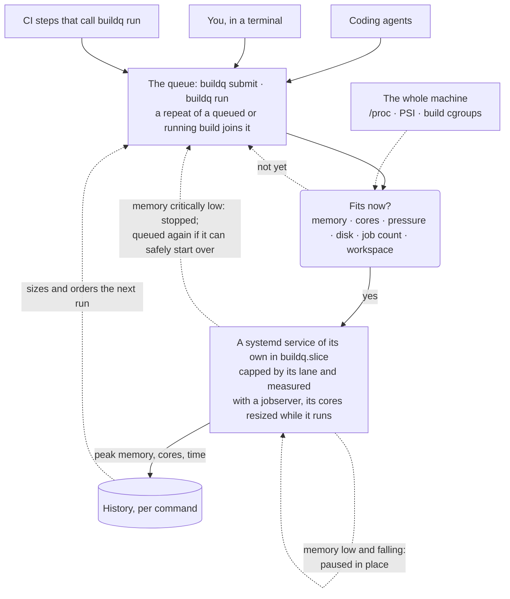

# buildq

**A load-aware build queue for one shared Linux machine.** Drop off a build, get a ticket; buildq
runs it when the machine has room, sized to fit.

[](https://github.com/nosliwsirhc/buildq/actions/workflows/tests.yml)


[](LICENSE)

**Completely open source:** buildq is free software under the [MIT License](LICENSE), and all of it
is in this repository.

When several people, coding agents and CI runners share a build box, each starts compiles and test
suites without knowing what the others are doing. Left alone, they pile on until the machine runs
out of memory. Put behind a fixed number of slots, they wait in line while most of the cores sit
idle: a slot held by a single-threaded link step, or by a test suite waiting on a database, counts
the same as one held by a 16-core compile.

buildq replaces the slot count with measurement.

| | A fixed number of slots | buildq |
| --- | --- | --- |
| **When a build starts** | a slot is free | its expected peak memory fits in what's free, and, while other builds run, there are cores for it |
| **What it sees** | its own jobs | the whole machine: CI runners, containers, anything outside the queue |
| **How big a build is** | every build is "one slot" | learned from that command's past runs |
| **Cores per build** | whatever the build picks | sized to the build and the machine; builds that use a jobserver (cargo, `make -j`, ninja) are resized while they run |
| **When memory runs out anyway** | the machine stalls | buildq pauses its newest build in place while memory falls, and stops one when it gets critically low; a build that can safely start over is queued again at the front |

## How it works



With a systemd user session, every build runs as a systemd service of its own, so it can be capped
and measured. What it used is recorded under its command (repository, lane, tool, subcommand,
package), and the next run of that command is planned from it. The daemon re-plans every second and
whenever a build arrives or ends.

## What you get

| Feature | What it does |
| --- | --- |
| **Admission by measurement** | A build starts when its expected peak memory fits in what is free, after setting aside room for running builds to grow into. While other builds run, it also waits for free cores and low CPU pressure, unless its lane doesn't wait for CPU. [How it decides](docs/scheduling.md#when-a-build-starts) |
| **Learned sizes** | Peak memory, peak cores and time are recorded per command, and the next run is planned with them. [Estimates](docs/scheduling.md#estimates) |
| **Cores that follow the load** | Each build starts with the cores that are free and memory allows, between its lane's minimum and what its history says it can use. Cargo, `make -j` and Ninja builds get a jobserver of their own, which buildq resizes with the load. [Cores](docs/scheduling.md#cores) has the conditions. |
| **Quick builds first** | Lanes have priorities; at the same priority, after fair shares, the build expected to finish soonest goes first. A build that has waited `starve_seconds` goes ahead of them all, so slow builds aren't passed for ever. A front-end lane can have turns of its own and never wait for CPU. [Order](docs/scheduling.md#order) |
| **CI first, if you want** | With `ci_first`, a GitHub Actions step gets a head start and holds the room it needs from builds of its priority or lower, so a release is less likely to time out in the queue. A build that has waited three times `starve_seconds` or was stopped to free memory still goes ahead of it. With `make_room_for_ci`, a step that has waited that long for memory stops the newest agent builds that can safely start over. [CI jobs](docs/ci.md) |
| **Caps** | Lanes give their builds systemd limits (`MemoryHigh`, `MemoryMax`, CPU and IO weights). All builds share one slice, whose memory limit the daemon keeps in line with what the machine has free, so when other work grows, builds are slowed or stopped, not the machine. |
| **Memory given back** | When other work takes the memory anyway, buildq pauses its newest build in place while memory is low and falling, and stops one when it gets critically low, before the machine can stall. A compile or test run (cargo, dotnet, ninja, tsc, eslint, vitest) or a build submitted with `--restartable` is queued again at the front; anything else fails, saying why. [When memory runs short](docs/scheduling.md#when-memory-runs-short-anyway) |
| **One build per source** | A repeat submission (the same command on the same source, in the same directory, lane, environment and settings) joins the build already queued or running, and a check that passed on it within `reuse_window` isn't run again. [The same source](docs/usage.md#the-same-source-the-same-build) |
| **Fair shares** | At the same priority, the caller (a session, a CI runner) with fewer builds running goes first. |
| **Tickets** | A build dropped off with `buildq submit` doesn't depend on whoever submitted it, its terminal or the daemon: agents submit, go on working, and check back. `buildq run` waits for it, streams its output and exits with its code; builds have no stdin or terminal. [Using buildq](docs/usage.md) |
| **Visibility** | `buildq top` is a live view like btop. `buildq report --capacity` says what builds waited for, and SQLite analytics answer the rest. [Operating](docs/operations.md) |
| **Small** | The Python 3.11 standard library, a POSIX shell script and three systemd user units. No root. |

## Quick start

You need Linux with cgroup v2, Python 3.11 or newer, and a systemd user session. Without one,
`install.sh` installs the programs, the config and the skill page, but no units; it doesn't set up the
shims or the guard, or start the daemon.
buildq is built on systemd, so a daemon started by hand (`buildqd`) queues builds but runs them
without limits, unmeasured, and never pauses or stops them to free memory.

```sh
git clone https://github.com/nosliwsirhc/buildq.git
cd buildq
./install.sh                       # the daemon and the client
./install.sh --shims               # optional: heavy commands go through the queue by themselves
./install.sh --rustc-guard=~/src   # optional: cargo under ~/src refuses to compile Rust outside the queue
./install.sh --skill               # optional: a skill that teaches coding agents to use the queue
```

`install.sh` does the following:
- puts `buildq`, `buildqd`, `buildq-shim` and `buildq-rustc-guard` in `~/.local/bin` (`PREFIX` changes that), with the Python it checked written into them (`PYTHON` chooses it; a virtualenv's is replaced by the Python it was made from), so a different `python3` on `PATH` later can't break them;
- writes `~/.config/buildq/config.toml` if there isn't one;
- installs `buildq.socket`, `buildq.service` and `buildq.slice` into `~/.config/systemd/user`, with a fixed memory backstop for all builds together (75%/85% of memory, in `buildq.slice.d`);
- starts the daemon.

While the daemon runs, it lowers the slice's limit below that backstop to what builds hold plus
what the machine has free. To upgrade, run `install.sh` again: running builds carry on,
and queued ones keep their place.

On a build server, keep the daemon running while you're logged out with `loginctl enable-linger "$USER"`.
`./install.sh --uninstall` removes everything except your configuration and state (history, tickets, analytics).

Then drop off a build. (This output is from a machine with a `heavy` lane and history for this command; a fresh install has one `default` lane.)

```console
$ buildq submit -- cargo test -p api
3f2a91c0-7c1e-4d55-9a0e-2b8f1c6d9e11
buildq: ticket 3f2a91c0-7c1e-4d55-9a0e-2b8f1c6d9e11 [heavy] queued for 0s: needs 18G of memory; 9.6G is free ...

$ buildq status 3f2a
ticket 3f2a91c0-7c1e-4d55-9a0e-2b8f1c6d9e11  (heavy lane)
  state     running for 4m12s, after 1m03s in the queue
  command   cargo test -p api
  in        ~/src/project/api
  using     7.6 cores, 11G now; peak 14G, 8.0 cores
  cores     8 given (resized live through its jobserver); it can use up to 12
  expected  8 cores, 18G (largest of the last 6 runs)
  log       ~/.local/state/buildq/tickets/3f2a91c0-.../output.log

$ buildq wait 3f2a; echo "exit $?"
buildq: 3f2a91c0 succeeded after 6m40s; peak 14G, 8.0 cores
exit 0
```

## Commands

| Command | What it does |
| --- | --- |
| `buildq submit [OPTIONS] [--] COMMAND…` | queue a build and print its ticket |
| `buildq run [OPTIONS] [--] COMMAND…` | queue it, stream its output, and exit with its code |
| `buildq status [TICKET…] [--json]` | a ticket in detail, or the queue and the machine |
| `buildq list [--all] [--json]` | every ticket: queued, running and recently finished |
| `buildq wait TICKET [--timeout DURATION]` | block until it finishes, then exit with its code |
| `buildq logs TICKET [--follow] [--tail N]` | its output |
| `buildq cancel [--all] TICKET…` | take it out of the queue, or stop it (`--all` stops one that others share) |
| `buildq pause [REASON]`, `buildq resume` | start nothing new while running builds carry on, or go on again |
| `buildq report [--since 7d] [--by lane]` | what the history says, per command (or `--by lane`, `--by caller`) |
| `buildq report --capacity [--hourly]` | what builds waited for, and what sat idle meanwhile |
| `buildq top [--interval 2] [--once]` | a live view of the machine and each build, like btop |
| `buildq query ["SQL"] [--json]` | a read-only query on the analytics (none: list the tables) |
| `buildq help agents` | the page for coding agents |
| `buildq ping` | check that the daemon answers |

A ticket is a UUID; any unique prefix of four or more characters works in its place. The options
(`--lane`, `--cores`, `--mem`, `--priority`, `--timeout`, `--name`, `--notify`, `--again`,
`--reuse`, `--restartable`), exit codes and environment variables are in
[Using buildq](docs/usage.md).

## Documentation

| Page | Read it for |
| --- | --- |
| [Using buildq](docs/usage.md) | every option, exit codes, joining and reusing builds, `run` vs `submit`, notifications, environment variables |
| [How buildq decides](docs/scheduling.md) | when a build starts, the order, memory shedding, past the peak, estimates, cores, lanes |
| [Coding agents](docs/agents.md) | shims, the Rust guard, the agents' skill, migrating from a slot script |
| [CI jobs](docs/ci.md) | queueing a workflow step on a self-hosted runner, `ci_first`, a new step's first run |
| [Operating buildq](docs/operations.md) | logs, the memory watch, restarts, files, analytics, `buildq top`, configuration errors, reboots, reports, GitHub statuses |
| [Benchmarking](docs/benchmark.md) | replaying builds against the scheduler: scenarios, comparing two versions or configurations, a trace from your machine |
| [Design](docs/design.md) | the internals: the daemon, the protocol, the analytics schema |
| [config.example.toml](config.example.toml) | every setting, with what it does |

## Limitations

| Limitation | What it means |
| --- | --- |
| **One machine and one user** | The socket is private to the user who runs the daemon. Several users each need their own daemon, and those daemons don't coordinate, though each sees the others' load in the machine-wide numbers. |
| **The user is the trust boundary** | Every process of that user can submit, list, watch and cancel every build, and pause or resume the queue, CI jobs under the same user included, and can read a build's environment while it is queued or running. Where a CI runner runs code you don't trust, run it as a separate user (with its own daemon) rather than through this one. [Design, Security](docs/design.md#security) |
| **Estimates, not guarantees** | A command that suddenly needs far more than before is planned by its history. Per-build `MemoryMax` and the slice backstop are what keep that from hurting the machine. |
| **Sampling** | Memory is sampled once a second from the build's cgroup (anonymous memory, shared memory and unreclaimable kernel memory; page cache is left out because the kernel can take it back). A spike shorter than a second can be missed. |
| **Work outside the build's cgroup** | Anything a build hands to a daemon runs in that daemon's cgroup: a test database in Docker, and above all `docker build`, whose compile runs in dockerd. It counts as machine load but not in the build's history, so give such commands a lane whose `min_mem` is what they really need, and route them there with a lane rule. (That is why the shims leave `docker` alone.) |
| **Fair shares count builds, not their size** | A caller with one 16-core build running goes before one with two 1-core builds. Priorities still come first. |
| **Reuse trusts the source, as git sees it** | A check that passed is taken as passing again on the same source, environment and settings. The fingerprint doesn't see what lies outside the repository (a path dependency in `../shared`, `~/.cargo/config.toml`, installed toolchains) or ignored files other than `.env*`, and a test can depend on other things (a database's contents, the network, the time). `--again` runs it; `reuse_window = "0"` turns reuse off. |
| **A daemon restart forgets running builds' environments** | A build stopped to free memory after one fails instead of being queued again. |

## Alternatives

Before writing buildq we looked for something that already did this. None did, but several had
ideas buildq has taken since (see [Credits](#credits)).

| Tool | How it admits work | What it lacks here |
| --- | --- | --- |
| **[qex](https://github.com/stephenc/qex)** | The closest: a local job queue for coding agents that learns per-command sizes. It admits jobs by their claimed cores and memory against a budget, checks free memory before each start, and can pass explicitly claimed cores to the job as environment hints. | It doesn't measure CPU load it didn't start, cap a job's memory, or resize a job's parallelism while it runs. |
| **Slurm** (single node) | It allocates the CPUs and memory a job *requests*. | A job that requests eight cores and uses one still holds eight, and Slurm schedules by requests, not by the spare capacity it measures. It needs root and several daemons. |
| **pueue**, **task-spooler**, **GNU parallel's `sem`** | They run up to a fixed number of jobs at once. | That is the slot model buildq replaces. |
| **`batch`** (atd) | It starts queued jobs when the load average drops. | It runs them detached, with output by mail. |
| **systemd on its own** | cgroup limits and weights | No queue. |

## Credits

buildq takes ideas, and no code, from these projects. Thank you to their authors.

- **[qex](https://github.com/stephenc/qex):**
  - A repeat submission joins the job already queued or running. qex's `--dedupe-key` asks the caller for a key; buildq derives one from the source being built.
  - `wait` ends a failed job with its last lines of output.
  - The agents' page is built into the program (`qex help agents`; here, `buildq help agents`).
  - Agents get a skill on using the queue.
- **[GNU parallel](https://www.gnu.org/software/parallel/):**
  - With [`--memsuspend`](https://www.gnu.org/software/parallel/parallel.html), jobs are suspended when memory runs low.
  - With [`--memfree`](https://www.gnu.org/software/parallel/parallel.html), the youngest job is killed and put back on the queue.
  - buildq's memory shedding pauses its newest build while memory is low and falling, or stops one when memory is critically low, and queues it again if it can safely start over.
- **[Slurm](https://slurm.schedmd.com/):**
  - [Preemption that requeues](https://slurm.schedmd.com/preempt.html) a stopped job instead of failing it.
  - [Fair-share](https://slurm.schedmd.com/classic_fair_share.html) priority, here between sessions rather than users.
  - [`sacct`](https://slurm.schedmd.com/sacct.html)-style accounting, which became `buildq report`.
- **[pueue](https://github.com/Nukesor/pueue):** a paused queue starts no new tasks while the running ones carry on, as `buildq pause` and `buildq resume` do.
- **[systemd](https://systemd.io/):** buildq is built on systemd's features:
  - transient services and slices;
  - socket activation;
  - `MemoryHigh` and `MemoryMax`;
  - `CPUWeight` and `IOWeight`;
  - the cgroup freezer that pauses a build.

## Contributing

Issues and pull requests are welcome. [Develop](#develop) has how to run the tests, and
[docs/design.md](docs/design.md) how buildq works inside.

## Develop

```sh
python3 -m unittest discover -s tests -v                    # unit and end-to-end tests
BUILDQ_TEST_SCOPES=1 python3 -m unittest discover -s tests  # also with builds as systemd services
```

The end-to-end tests start a private daemon on a temporary socket and never touch an installed one.
CI runs the suite on Python 3.11 to 3.13, and once more in a systemd user session with GNU make 4.4,
so the systemd services, limits, pausing, the slice guard and make's jobserver are exercised too.
[docs/design.md](docs/design.md) describes the internals.

## License

buildq is completely open source, under the [MIT License](LICENSE). You may use it, change it and
share it, for any purpose, commercial or not, free of charge; the license asks only that its
copyright and permission notice go with copies of it, and gives no warranty. Everything is in this
repository, with nothing held back or sold separately: the daemon, the client, the shims, the Rust
guard, the installer, the docs and the tests.
